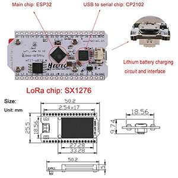
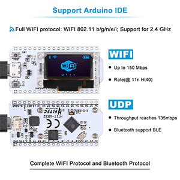

# heltec-wifikit32-lab

Laboratorio de experimentos con la placa **Heltec WiFi Kit 32** (ESP32 + OLED 0.96").

<p>
  
  
  
</p>

## La placa

Datos leídos directamente del chip con `esptool` (no son de la caja):

| | |
|---|---|
| Placa | Heltec WiFi Kit 32 **V2** (serigrafía `HTIT-WB32`; V2 por el ESP32 clásico + micro-USB + 8 MB) |
| Chip | ESP32-D0WDQ6 rev v1.0 — dual core, 240 MHz |
| Cristal | 26 MHz |
| Flash | 8 MB (Winbond, ID `ef/4017`) |
| RAM | ~520 KB SRAM, sin PSRAM |
| USB-serie | Silicon Labs CP2102 (conector micro-USB) |
| WiFi | 802.11 b/g/n, **solo 2.4 GHz**, antena impresa en la PCB |
| Bluetooth | BLE 4.2 + Bluetooth Clásico |
| Pantalla | OLED SSD1306 128×64 |
| Batería | Conector y cargador Li-Po |

### Cómo se compró

En Amazon aparece como **"MakerFocus ESP32 Development Board WiFi with 0.96inch
OLED Display WIFI Kit32 Arduino Compatible CP2012 for Arduino Nodemcu"**.
MakerFocus es el vendedor; la placa es la **Heltec WiFi Kit 32**, como indican
la caja y la serigrafía.

<p>
  
  
</p>

**Esta unidad es la V2, no la V3 que dice el anuncio.** La V3 usa un ESP32-S3 y
conector USB-C. Esta tiene un ESP32 clásico (D0WDQ6), conector micro-USB y 8 MB
de flash, que es exactamente la V2 (la V1 traía 4 MB).

El anuncio mezcla datos de varias versiones y de otras placas. Esto es lo que
dice comparado con lo medido en la placa:

| El anuncio dice | Realidad (medido con `esptool` o visto en la placa) |
|---|---|
| Modelo "WiFi Kit 32 (V3)" | **V2**: ESP32-D0WDQ6 + micro-USB + 8 MB. |
| "CP2012" | **CP2102** de Silicon Labs (USB `10c4:ea60`). Errata en el título; la descripción sí dice CP2102. |
| "RAM instalada 8 MB" | **~520 KB de SRAM, sin PSRAM.** Los 8 MB son la flash, no la RAM. |
| Flash de "8 MB", "32 MByte" y "4 MBytes (32 Mbits)" | Tres valores distintos en el mismo anuncio. Esta unidad tiene **8 MB**. Compruébalo en otras unidades con `esptool.py flash_id`. |
| CPU "Tegra" | **Tensilica Xtensa LX6** de doble núcleo a 240 MHz. Tegra es de NVIDIA y no tiene nada que ver. |
| "Lexin ESP32" | Lexin (乐鑫) es el nombre en chino de **Espressif**, el fabricante del ESP32. |
| Alimentación por "tipo C" | Esta unidad tiene **micro-USB**. |
| Imagen: "LoRa chip: SX1276" | **No tiene LoRa.** La imagen es de la Heltec *WiFi LoRa 32*. Esta placa no tiene SX1276 ni conector de antena IPEX, así que **no sirve para Meshtastic** sin un módulo LoRa externo. |
| "Arduino Nodemcu", "esp8266" | Palabras clave para búsquedas. No es una NodeMCU ni un ESP8266. Es compatible con Arduino, pero con su propio pinout (ver abajo). |
| WiFi 802.11 b/g/n/e/i | Correcto. `e` (QoS) e `i` (seguridad WPA2) son extensiones del estándar. **Solo 2.4 GHz.** |

Datos del anuncio que concuerdan con la hoja de datos del ESP32 pero que **no se
han verificado** en esta placa:

| Dato | Valor |
|---|---|
| Medidas (imagen) | 50.2 × 25.5 mm, 2 filas de 18 pines a 2.54 mm |
| Voltaje de funcionamiento | 3.3 V a 7 V |
| Temperatura | −40 °C a +90 °C |
| Velocidad WiFi | 150 Mbps (11n HT40), 72 Mbps (HT20), 54 Mbps (11g), 11 Mbps (11b); UDP hasta 135 Mbps |
| Potencia de transmisión | 19.5 dBm (11b), 16.5 dBm (11g), 15.5 dBm (11n) |
| Sensibilidad del receptor | hasta −98 dBm |
| Batería | conector SH1.25 de 2 pines (paso de 1.25 mm) con cargador Li-Po integrado |
| Modos WiFi | Station, softAP, Sniffer y WiFi Direct (el radar usa Station y Sniffer) |
| Contenido | 1 placa + 2 tiras de pines |

Para buscar documentación o librerías, usa el nombre **Heltec WiFi Kit 32 V2**
(en PlatformIO: `board = heltec_wifi_kit_32_V2`), no el del vendedor.

## Pines útiles

| Función | GPIO |
|---|---|
| OLED SDA | 4 |
| OLED SCL | 15 |
| OLED RST | 16 |
| LED integrado | 25 |
| Botón PRG | 0 (activo en LOW, usar `INPUT_PULLUP`) |

## Botones

- **RST** — reinicia el ESP32.
- **PRG** — conectado a GPIO0.
  - Modo bootloader manual: mantener PRG → pulsar y soltar RST → soltar PRG.
    Solo hace falta si la subida falla con *"Failed to connect"*.
  - Una vez arrancado el programa, se puede leer como botón de usuario.

## Particiones

La flash es de 8 MB, pero la tabla de fábrica solo usa los primeros 4 MB:

| Partición | Offset | Tamaño |
|---|---|---|
| nvs | 0x009000 | 20 KB |
| otadata | 0x00E000 | 8 KB |
| app0 | 0x010000 | 1.25 MB |
| app1 | 0x150000 | 1.25 MB |
| spiffs | 0x290000 | 1.44 MB |
| *(sin usar)* | 0x400000 | 4 MB |

Los proyectos de este repo usan `partitions_8mb.csv`, con los 8 MB completos:
3 MB por app (×2 para OTA), ~1.9 MB de archivos y 64 KB de coredump.

## Conexión en macOS

- Puerto: `/dev/cu.usbserial-0001`
- Monitor serie: 115200 baudios
- El firmware de fábrica imprime `Serial initial done` / `OLED initial done!` al arrancar.

```sh
pip install esptool
esptool.py --port /dev/cu.usbserial-0001 flash_id
```

## Proyectos

Cada experimento vive en su propia carpeta.

| Proyecto | Descripción |
|---|---|
| [`radar-wifi/`](radar-wifi/) | **Hackwise Scanner**: lista de redes por potencia, rastreo de una red con distancia estimada, tendencia (acercando/alejando) y equipos activos. [Guía de uso](radar-wifi/docs/operacion.md). |

```sh
cd radar-wifi
pio test -e native            # pruebas de la lógica en la Mac
pio run -e heltec -t upload   # compilar y grabar
```
